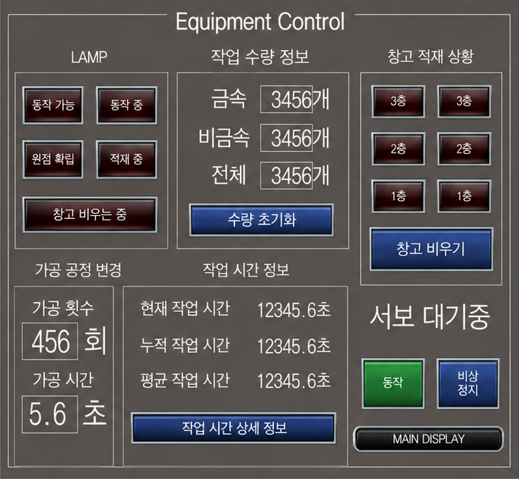
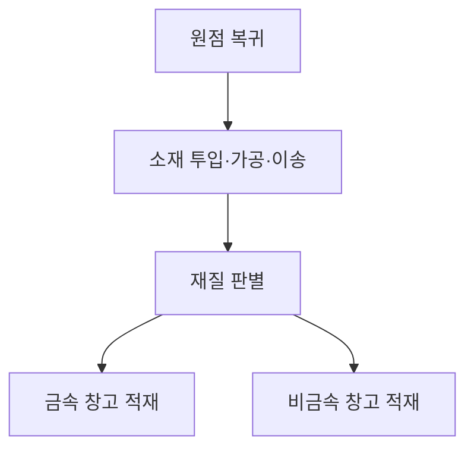
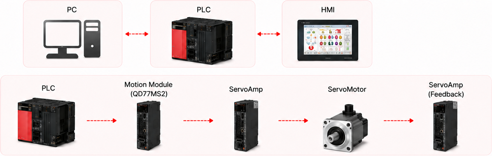
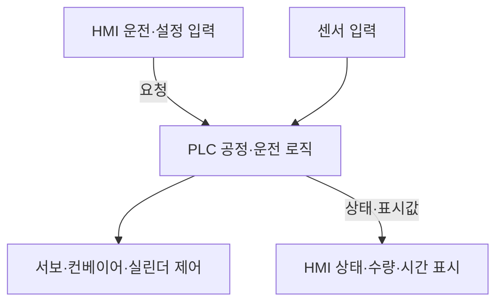
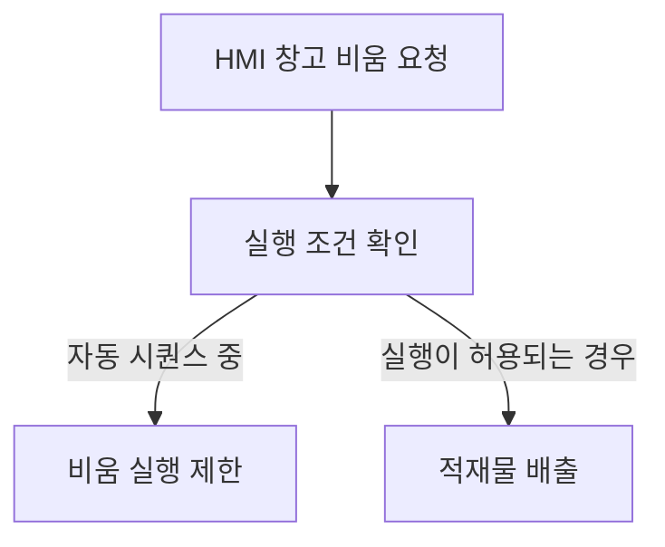
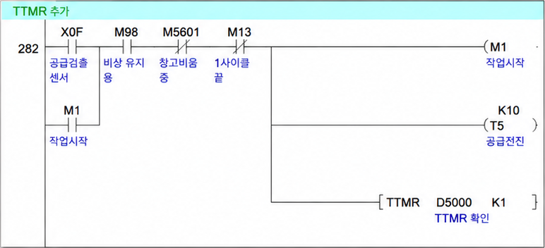

# PLC | 자동화 공정 제어 및 HMI

소재의 투입·분류·적재를 연결하는 2인 팀 자동화 공정에서 **창고 비움·작업 시간 측정·HMI 구성**을 담당했습니다.

*팀 전체 Equipment Control 화면입니다. 표시된 시간·수량은 화면 구성 예시이며 측정 성능이 아닙니다.*

## 1. Project Overview

PLC 래더와 HMI를 이용해 소재의 가공·이송·재질 판별·창고 적재를 연결하고, 운전자가 설비 상태를 확인하며 별도의 창고 비움 기능을 실행하는 프로젝트입니다.

| 항⁠목 | 내용 |
| --- | --- |
| 발⁠표 | 2026.06 발표 — 개발 시작·종료일은 미확정 |
| 팀⁠ ⁠구⁠성 | 2인: 최은비, 류상균 |
| 제⁠어⁠ ⁠장⁠비 | Mitsubishi Q03UDV CPU, QD77MS2 모션 모듈, MR-J4-B 서보 시스템 |
| 공⁠정⁠ ⁠장⁠비 | 서보·컨베이어·실린더·센서 |
| 개⁠발⁠ ⁠도⁠구 | GX Works2, GT Designer3 |
| 기⁠본⁠ ⁠공⁠정 | 원점 복귀 → 투입·가공·이송 → 재질 판별 → 적재 |

**창고 비움은 기본 자동 공정과 구분된 별도 운전 기능**입니다. 자동 시퀀스 중에는 비움 실행을 제한하는 것으로 발표자료에 기록되어 있습니다.

## 2. My Contribution

| 담⁠당⁠ ⁠기⁠능 | 주요 수행 내용과 근거 |
| --- | --- |
| 창⁠고⁠ ⁠비⁠움 | 적재물을 배출하는 기능 담당. 역할분담 문서와 발표자료 3쪽에 기록되어 있습니다. |
| 시⁠간⁠ ⁠측⁠정 | 작업 시간 측정 관련 래더 담당. 발표자료 10쪽의 작업 시작·시간 측정 부분 캡처를 근거로 설명합니다. |
| H⁠M⁠I⁠ ⁠구⁠성 | 설비 상태·작업 시간 표시 및 운전 기능 구성에 참여했습니다. 발표자료 3·11~13쪽에서 담당과 화면 구성을 확인했습니다. |
| 기⁠능⁠ ⁠연⁠결 | 창고 비움 요청과 상태 표시 등 PLC–HMI 기능 연결을 담당 범위로 정리합니다. 객체별 디바이스 주소와 최종 연결 설정은 미검증입니다. |

류상균의 담당은 **기본 공정 시퀀스·Teaching·설비 점검·비상정지**입니다. 공통 래더와 팀 HMI 전체를 개인 단독 구현으로 소개하지 않습니다. 화면별 신규 작성·수정 범위와 최종 래더 전체의 작성 범위는 별도 확인이 필요합니다.

## 3. System Architecture

다음 도식은 발표자료에서 확인한 **개념적 기능 관계**입니다. 최종 원본의 상세 상태 전이나 통신 설정을 재현한 도식은 아닙니다.

### 전체 자동 공정

*발표자료 5쪽에 기반한 장비 구성 설명 이미지입니다. 실물 설비 전체 사진이 아닙니다. 팀 전체 제어·모션 구성을 보여줍니다.*

### PLC–HMI 기능 연결

HMI 통신 프로토콜과 객체별 PLC 주소는 이 도식에서 특정하지 않습니다.

### 별도 창고 비움

예약 실행·시퀀스 종료 후 자동 실행·상세 완료 조건은 확인되지 않아 포함하지 않았습니다.

## 4. Key Implementation

### 4.1 창고 비움 — 자동 공정과 분리한 운전 기능

창고에 적재된 소재를 배출하는 기능으로, HMI의 창고 비움 요청과 PLC의 동작 처리를 연결합니다. 발표자료 9쪽에는 **자동 시퀀스 동작 중 창고 비움 방지**가 명시되어 있습니다.

담당 기능과 실행 제한은 자료로 확인했지만, 최종 래더에서 요청을 처리하는 디바이스·전체 인터락·배출 완료 조건은 직접 검증하지 못했습니다. 따라서 화면의 버튼 존재와 최종 로직 검증을 구분합니다.

### 4.2 작업 시간 측정 — 래더 캡처로 확인한 처리

*발표자료 10쪽, 래더 스텝 282의 작업 시작·시간 측정 관련 부분입니다. 전체 프로그램 캡처가 아닙니다.*

| 접⁠점⁠·⁠명⁠령 | 캡처에서 확인한 관계 |
| --- | --- |
| `X0F` / `M1` | 공급 검출 센서로 표시된 X0F 접점과 M1 접점이 병렬입니다. M1 경로는 X0F를 우회하는 자기 유지 형태입니다. |
| `M98` | 비상 유지용으로 표시된 접점이 직렬로 연결되어 있습니다. 전체 비상정지 처리를 이 접점 하나로 설명하지 않습니다. |
| `M5601` | 창고 비움 중으로 표시된 B접점이 직렬 조건에 포함됩니다. 캡처 밖의 전체 인터락은 미확인입니다. |
| `M13` | 1사이클 끝으로 표시된 B접점이 직렬 조건에 포함됩니다. 종료 신호의 생성 로직은 이 캡처에 없습니다. |
| `M1` 코일 | 앞의 조건 뒤에 작업 시작으로 표시된 코일이 연결됩니다. |
| `T5 K10` | 같은 조건에서 분기된 타이머 명령입니다. 공급 전진 주석과 설정값 K10을 확인할 수 있으며 실측 시간으로 해석하지 않습니다. |
| `TTMR D5000 K1` | 같은 조건에서 분기된 시간 측정 관련 명령과 피연산자를 확인했습니다. D5000의 HMI 직접 연결은 미확인입니다. |

측정 종료·리셋·평균·누적 계산과 HMI 표시값의 산출 과정은 이 캡처만으로 확인할 수 없습니다.

### 4.3 HMI 구성 — 조작과 상태 확인

| 화⁠면⁠·⁠영⁠역 | 발표자료에서 확인한 구성 |
| --- | --- |
| M⁠a⁠i⁠n | 메인 화면과 운전 화면 구성. 발표자료 11쪽. |
| Equipment Control | 운전 가능·동작 중·원점 복귀 등 상태 표시, 수량과 적재 상태, 창고 비움 관련 표시·조작. 발표자료 12쪽 및 상단 이미지. |
| 작⁠업⁠ ⁠시⁠간 | 현재·이전·평균·누적 시간 등 표시 영역과 상세 화면. 발표자료 12~13쪽. |

개인 담당은 HMI 구성 기여이며, 표는 **팀 전체 화면에서 확인되는 기능**을 설명합니다. 각 객체의 신규 작성자와 디바이스 연결은 최종 HMI 원본 대조가 필요합니다. 화면 예시 숫자는 실제 공정 성능이나 반복 시험 결과가 아닙니다.

## 5. Troubleshooting

### 창고 비움 중 스토퍼 간섭 — 팀 통합 과정의 기록

| 단⁠계 | 발표자료 14쪽의 기록과 해석 |
| --- | --- |
| 문⁠제 | 창고 비움 동작 중 서보와 스토퍼가 간섭하여 기구부가 끼는 현상이 기록되어 있습니다. |
| 원⁠인⁠ ⁠검⁠토 | 적재 시에는 스토퍼가 위치를 보정하지만 비움에는 위치 보정 요소가 없어 소재 위치 오차가 발생했다는 설명입니다. 실측으로 독립 검증한 원인은 아닙니다. |
| 조⁠치 | 흡착 전에 스토퍼 실린더를 동작하도록 추가했다고 기록되어 있습니다. |
| 담⁠당⁠ ⁠관⁠계 | 창고 비움은 개인 담당 기능이지만, 이 조치의 직접 수정·장비 조정·시험 분담은 확인되지 않았습니다. |
| 확⁠인⁠ ⁠결⁠과 | 발표자료의 문제·원인·조치 기록을 확인했습니다. 최종 래더 반영 위치, 반복 실물 시험과 간섭 재발 여부는 미확인입니다. |

이 사례는 개인의 문제 해결 완료 성과가 아닌 **팀 통합 조치 기록**으로 제시합니다.

## 6. Results & Verification

| 검⁠증⁠ ⁠구⁠분 | 확인 내용 및 한계 |
| --- | --- |
| 역⁠할⁠ ⁠기⁠록 | 창고 비움·작업 시간 측정·HMI 구성 담당을 확인했습니다. 최종 래더와 HMI 전체의 개인 단독 작성 범위를 뜻하지 않습니다. |
| 래⁠더⁠ ⁠캡⁠처 | 스텝 282의 접점과 M1, T5 K10, TTMR D5000 K1을 확인했습니다. 최종 원본 및 종료·리셋·집계 처리는 미검증입니다. |
| H⁠M⁠I⁠ ⁠화⁠면 | 상태·수량·창고 비움·시간 표시 구성을 확인했습니다. 예시 숫자는 실측 성과가 아니며 객체별 디바이스 연결은 미확인입니다. |
| 팀⁠ ⁠발⁠표⁠ ⁠기⁠록 | 공정 구성과 스토퍼 간섭의 문제·조치 기록을 확인했습니다. 수정 후 반복 성공과 완전한 해결은 확인되지 않았습니다. |
| 미⁠확⁠인 | 최종 PLC·HMI·서보 원본 내부, 세부 주소와 완료 조건, 실물 반복 시험·시간 측정 정확도·개인 직접 시험 범위는 미검증입니다. |

프로젝트 파일의 존재, 발표자료의 구현 설명, 실물 동작 검증은 서로 다른 근거입니다. HMI 예시 시간·수량이나 시연 정지 화면의 표시값을 성능 결과로 사용하지 않습니다.

## 7. Code & References

이 저장소는 개인 담당 구현을 설명하는 기술 문서와 승인된 화면을 제공합니다. 원본 프로젝트 다운로드는 제공하지 않습니다.

| 자⁠료 | 공개·확인 범위 |
| --- | --- |
| PLC `.gxw` | 파일 존재 확인. GX Works2에서 최종 내부 래더를 직접 대조하지 못했으며 원본 미공개입니다. |
| 서보 `.pcw` | 설정 파일 존재 확인. 적용본·내부 설정 미검증, 원본 미공개입니다. |
| HMI `.gt32` 및 관련 자료 | 관련 파일은 있으나 완전한 프로젝트의 로딩·객체 연결을 검증하지 못했습니다. 원본·관리 자료는 미공개입니다. |
| 발⁠표⁠자⁠료 | 3쪽 역할, 4~5쪽 장비, 9쪽 실행 제한, 10쪽 래더, 11~13쪽 HMI, 14쪽 통합 조치를 참고했습니다. 전체 자료는 게시하지 않습니다. |
| 승⁠인⁠ ⁠화⁠면 | 본문에 사용한 HMI·장비 구성·래더 이미지 3개입니다. |
| 사⁠용⁠ ⁠도⁠구 | GX Works2, GT Designer3. 재현 가능한 장치 전송·기동 절차는 미확정입니다. |

- [PLC 웹 포트폴리오](https://hyaline-52.github.io/plc.html)
- [HMI 화면](assets/plc/equipment-control-hmi.png) · [장비 구성](assets/plc/equipment-overview.png) · [시간 측정 래더](assets/plc/tact-time-ladder.png)
