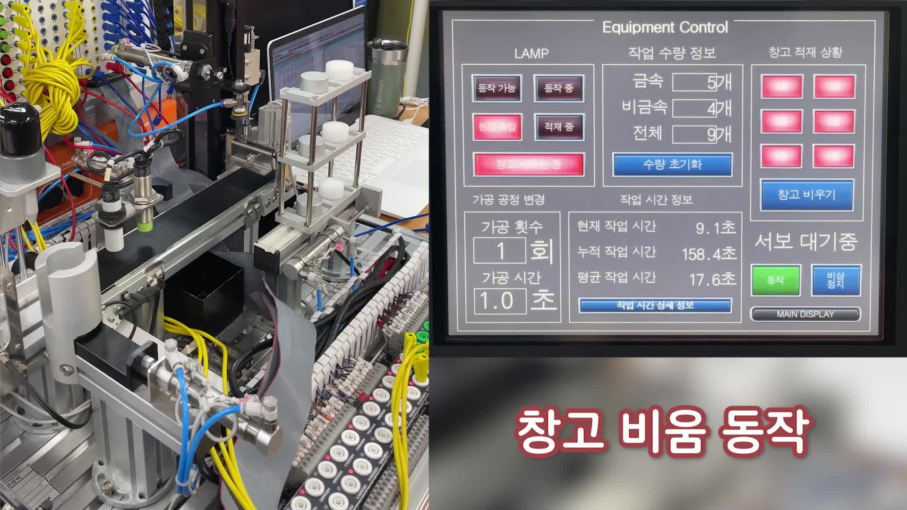
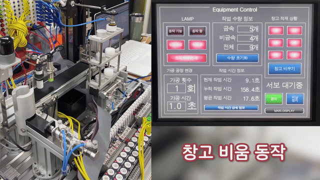

# PLC Automated Warehouse · 자동화 공정 제어 및 HMI

소재 투입·이송·재질 판별·창고 적재를 자동화하고, HMI에서 장비 상태를 확인하며 별도의 창고 비움 기능을 실행하는 프로젝트입니다.

## 프로젝트 개요

| 항목 | 내용 |
|---|---|
| 개발 기간 | 2026.06 |
| 팀 구성 | 2명 |
| 제어 장비 | Mitsubishi Q03UDV CPU, QD77MS2 모션 모듈, MR-J4-B 서보 시스템 |
| 공정 장비 | 서보·컨베이어·실린더·센서 |
| 개발 도구 | GX Works2, GT Designer3 |
| 주요 기능 | 소재 공급·분류·적재, 창고 비움, 작업 시간 측정, HMI 운전·상태 표시 |

## 동작 시연

창고에 적재된 소재를 순서대로 꺼내 배출합니다.

[▶ 전체 시연 영상 보기 · YouTube](https://youtu.be/cHd10eNT1wA)

## SYSTEM FLOW

### 소재 공급부터 창고 비움까지의 공정

| 구분 | 동작 |
|---|---|
| 01 공급·분류·적재 | 소재를 투입하고 재질별로 분류해 창고에 적재 |
| 02 창고 비움 | 창고에 적재된 소재를 순서대로 꺼내 배출 |
| 03 운전 상태·시간 확인 | HMI에서 운전 상태와 작업 시간을 실시간으로 확인 |

창고 비움은 기본 자동 공정과 구분된 별도 운전 기능입니다. 자동 적재 시퀀스 동작 중에는 비움 실행을 제한합니다. HMI는 운전 중 상태와 시간을 표시합니다.

## PLC·HMI 구성

*창고 비움 조작과 운전 상태·작업 시간 표시. 화면의 숫자는 표시 예시입니다.*

| 구성 | 내용 |
|---|---|
| 기본 자동 공정 | 원점 복귀, 소재 투입·가공·이송, 재질 판별과 적재 |
| 창고 비움 | HMI 요청에 따라 적재된 소재를 순차 배출 |
| 작업 시간 측정 | 작업 시작 조건에 TTMR 명령을 연결해 진행 시간 측정 |
| HMI | 운전 요청, 장비 상태·적재 상태·작업 시간 표시 |
| 실행 조건 | 시퀀스 간 실행 상태를 구분해 중복 동작 방지 |

TTMR 시간 측정 래더 보기

`X0F`·`M1`의 작업 시작 조건에 `M98`, 창고 비움 중 상태인 `M5601`, 1사이클 종료 상태인 `M13` 조건이 연결됩니다. 같은 조건에서 `TTMR D5000 K1` 명령으로 시간을 측정합니다.

이 이미지는 작업 시작·시간 측정 부분입니다. 종료·리셋·집계 로직 전체나 HMI 객체별 주소를 나타내지는 않습니다.

## 개인 담당

창고 비움, TTMR 기반 작업 시간 측정, HMI 구성과 코드 통합을 담당했습니다. 코드 통합 후 시퀀스 간섭과 창고 비움 중 스토퍼 간섭을 수정했습니다.

[개인 구현·문제 해결 보기 →](https://hyaline-52.github.io/plc.html)

## 제공 자료

이 저장소는 공정 설명과 시각자료를 제공합니다. PLC·HMI·서보 원본 프로젝트의 다운로드는 제공하지 않습니다.

- [실물 설비](assets/readme/equipment-hmi-real.jpg)
- [HMI 화면](assets/readme/plc-hmi.png)
- [시간 측정 래더](assets/readme/plc-ladder.png)
- [전체 시연 영상](https://youtu.be/cHd10eNT1wA)

시연과 화면 자료는 공정 동작·구성을 설명하며, 반복 성공률이나 시간 측정 정확도를 나타내는 성능 시험 결과는 아닙니다.
